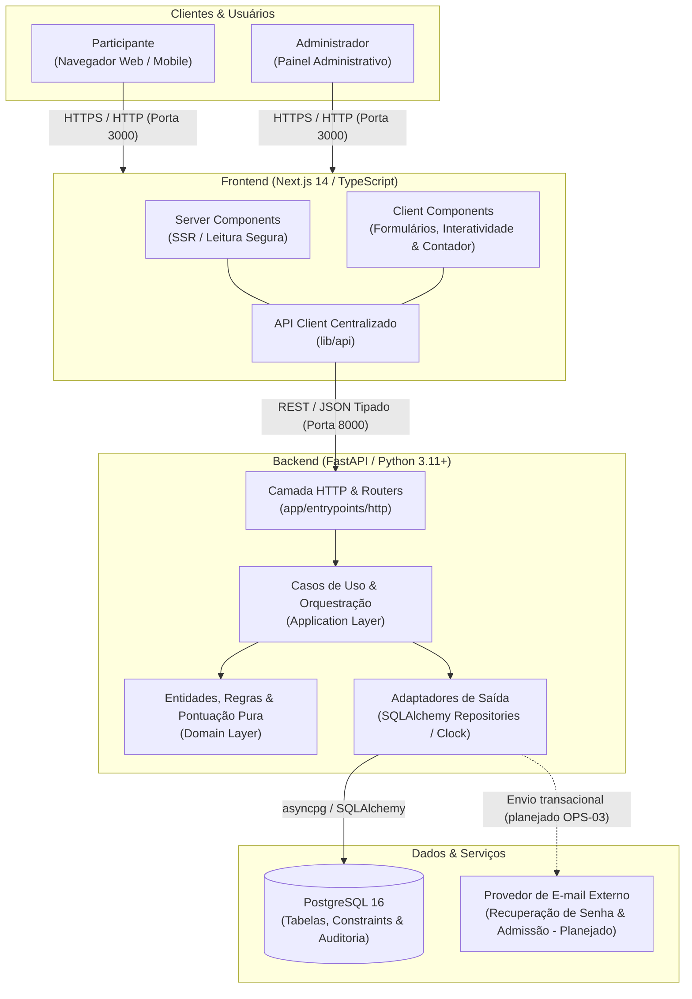
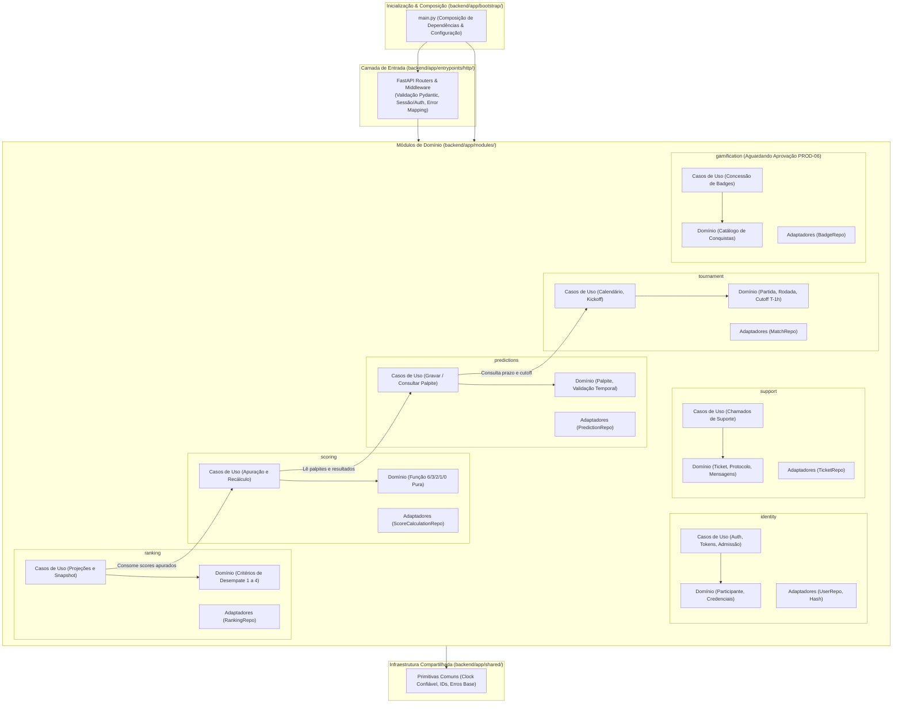
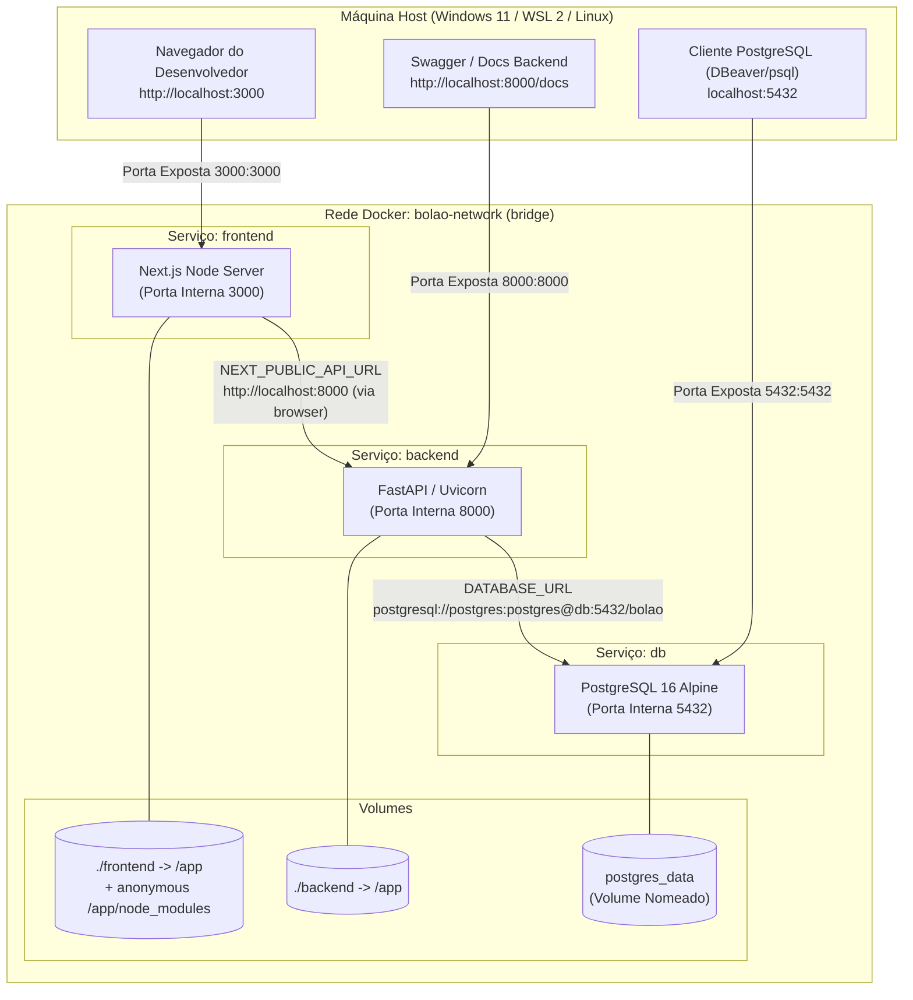
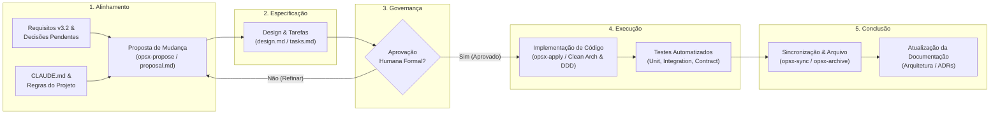

# Bolão Copa do Mundo Feminina da FIFA Brasil 2027™

Plataforma web de alta integridade e transparência para gestão de palpites e acompanhamento de ranking da Copa do Mundo Feminina da FIFA Brasil 2027™, operando sob o modelo de **Grupo Único**.

---

## Sumário

1. [Visão Geral](#1-visão-geral)
2. [Estado Atual do Projeto](#2-estado-atual-do-projeto)
3. [Arquitetura em uma Visão](#3-arquitetura-em-uma-visão)
4. [Tecnologias e Padrões](#4-tecnologias-e-padrões)
5. [Estrutura do Repositório](#5-estrutura-do-repositório)
6. [Docker Compose e Ambiente Local](#6-docker-compose-e-ambiente-local)
7. [Como Começar (Onboarding)](#7-como-começar-onboarding)
8. [Fluxo de Desenvolvimento com SDD e OpenSpec](#8-fluxo-de-desenvolvimento-com-sdd-e-openspec)
9. [Testes e Qualidade](#9-testes-e-qualidade)
10. [Mapa da Documentação](#10-mapa-da-documentação)
11. [Próximos Passos](#11-próximos-passos)

---

## 1. Visão Geral

O sistema é uma aplicação web moderna e responsiva voltada a um grupo privado único (comunidade, empresa ou organização) para disputa de palpites de placar nos 64 jogos da Copa do Mundo Feminina da FIFA Brasil 2027™ (24/06 a 25/07/2027).

### 1.1 Regras Fundamentais de Negócio (Requisitos v3.2)

- **Escopo do torneio:** 32 seleções nacionais, 8 grupos (A a H), 64 partidas (48 na fase de grupos e 16 no mata-mata) organizadas em 7 rodadas oficiais.
- **Sistema de pontuação decrescente e excludente:**
  - **6 pontos:** Acerto do placar exato.
  - **3 pontos:** Acerto do vencedor/empate + gols de exatamente uma equipe.
  - **2 pontos:** Acerto apenas do resultado (vitória/empate/derrota), errando o número de gols de ambos os times.
  - **1 ponto:** Erro do resultado geral, mas acerto dos gols de exatamente uma equipe.
  - **0 pontos:** Nenhuma das combinações anteriores.
- **Mata-mata oficial aos 120 minutos:** O placar apurado é o resultado ao fim dos 120 minutos de bola rolando (90 minutos regulamentares + prorrogação). **Gols em disputa de pênaltis não contam** para o placar do bolão. Partidas decididas nos pênaltis são computadas como **empate**.
- **Corte rigoroso (Cutoff):** A janela de palpites fecha exatamente **uma hora antes do kickoff oficial vigente** da partida ($T - 1\text{h}$).
  - O backend impõe validação baseada no **timestamp de recepção confiável gerado pelo servidor** (PROD-01).
  - Requisições recebidas antes do corte podem concluir sua gravação após ele; requisições recebidas no instante do corte ou depois são rejeitadas.
- **Sigilo e transparência temporal:**
  - Antes do corte, nenhum participante comum tem acesso aos palpites de outros concorrentes.
  - Após o corte, a grade de palpites da partida é tornada pública a todos os participantes.
  - Se houver alteração administrativa de horário de início que reabra a janela (PROD-02), novas consultas a palpites alheios voltam a ser ocultadas até o novo corte, sem restaurar sigilo de informações já observadas.
- **Critérios de desempate do ranking:**
  1. Maior quantidade de acertos de placar exato (6 pontos).
  2. Maior quantidade de acertos de 3 pontos.
  3. Maior pontuação acumulada em rodadas anteriores concluídas (desconsiderado na Rodada 1).
  4. Ordem alfabética pelo nome de exibição normalizado (sem acentos e sem diferenciação maiúsculas/minúsculas). Persistindo o empate, a classificação é compartilhada.
- **Fuso horário oficial:** Todo o sistema exibe datas e horários estritamente no **Horário de Brasília (BRT / UTC-3)**. Os instantes são armazenados em UTC.
- **Escopo excluído:** Sem apostas financeiras, sem ligas públicas/multi-tenancy, sem streaming de vídeo e sem integração automática paga com feeds externos de resultados (atualizações manuais auditadas via painel administrativo).

---

## 2. Estado Atual do Projeto

O repositório encontra-se no estágio de **fundação documental e scaffold de infraestrutura**. Não há código de negócio nem telas implementadas.

| Área | Estado Real | Detalhe |
|---|---|---|
| **Documentação Canônica** | **Implementada** | Requisitos v3.2, Decisões Pendentes v1.2, Arquitetura v0.3 e Proposta de Gamificação PROD-06 consolidadas em `docs/`. |
| **Governança SDD** | **Implementada** | OpenSpec configurado (`openspec/config.yaml`), com comandos e workflows para agentes de IA em `.claude/`, `.agents/`, `.roo/`, `.kiro/` e `.opencode/`. |
| **Topologia Local (Docker)** | **Configurada** | `docker-compose.yml` estruturado com 3 serviços (`frontend`, `backend`, `db`), rede bridge e volume persistente. |
| **Backend (FastAPI)** | **Scaffold Estrutural** | Estrutura de diretórios DDD/Clean Architecture criada, `pyproject.toml` configurado, `Dockerfile` multi-stage presente. Módulos em `app/modules/` contêm apenas `.gitkeep`. O entrypoint `app.bootstrap.main:app` ainda **não foi codificado**. |
| **Frontend (Next.js)** | **Scaffold Estrutural** | Estrutura App Router criada (`app/`, `features/`, `components/`, `lib/`), `package.json`, `tsconfig.json` e `Dockerfile` presentes. Não há páginas (`page.tsx`) ou layouts (`layout.tsx`) implementados ainda. |
| **Banco de Dados & Migrações**| **Scaffold** | Serviço PostgreSQL 16 declarado no Compose. Diretório `backend/migrations/` contém apenas `.gitkeep`; schemas e tabelas Alembic ainda não foram inicializados. |
| **Suíte de Testes** | **Scaffold** | Diretórios estruturados (`unit/`, `integration/`, `api/`, `contract/`), dependências declaradas (`pytest`, `ruff`, `mypy`), sem testes implementados. |

---

## 3. Arquitetura em uma Visão

A arquitetura adota um **monólito modular** no backend (FastAPI/Python), separado do frontend (Next.js/TypeScript) e do banco relacional (PostgreSQL 16), comunicando-se estritamente via API REST tipada.

### 3.1 Diagrama 1 — Arquitetura do Sistema



### 3.2 Diagrama 2 — Estrutura Arquitetural Modular (Backend)



---

## 4. Tecnologias e Padrões

### 4.1 Stack Tecnológica

| Componente | Tecnologia | Versão Declarada | Finalidade |
|---|---|---|---|
| **Frontend** | Next.js / React | `^14.0.0` / `^18.2.0` | Interface web com App Router, SSR e renderização híbrida |
| **Linguagem Frontend** | TypeScript | `^5.0.0` | Tipagem estática e contratos de dados |
| **Backend** | FastAPI / Python | `>=0.100.0` / `>=3.11` | API assíncrona de alto desempenho, documentação automática OpenAPI |
| **Servidor ASGI** | Uvicorn | `>=0.23.0` | Execução HTTP assíncrona do backend |
| **Validação** | Pydantic / Pydantic Settings | `>=2.0.0` | Validação de payloads e configurações tipadas de ambiente |
| **ORM / Banco** | SQLAlchemy / asyncpg | `>=2.0.0` / `>=0.28.0` | Mapeamento relacional assíncrono e controle transacional |
| **Migrações** | Alembic | `>=1.12.0` | Versionamento e evolução de schema do banco relacional |
| **Banco Relacional** | PostgreSQL (Alpine) | `16-alpine` | Banco de dados principal com suporte transacional estrito |
| **Qualidade Backend** | Ruff / Mypy / Pytest | `>=0.1.0` / `>=1.5.0` / `>=7.4.0` | Linter ultra-rápido, checagem estática de tipos e testes automatizados |
| **Qualidade Frontend** | ESLint / Next Lint | `^8.0.0` / `^14.0.0` | Padronização e qualidade de código React/Next.js |
| **Containers** | Docker & Docker Compose | Compose file v3.8 | Orquestração do ambiente de desenvolvimento local isolado |

### 4.2 Princípios Arquiteturais

1. **Monólito Modular:** Agrupamento por capacidades de negócio coesas (`identity`, `tournament`, `predictions`, `scoring`, `ranking`, `support`, `gamification`), compartilhando o mesmo processo backend e banco relacional, sem a sobrecarga operacional de microserviços.
2. **Clean Architecture e DDD Pragmático:**
   - **Camada de Domínio (`domain/`):** Objetos de valor, entidades e funções de negócio puras (ex.: pontuação 6/3/2/1/0, cálculo do cutoff), totalmente desacopladas de frameworks, HTTP ou ORM.
   - **Camada de Aplicação (`application/`):** Casos de uso orquestrando domínio e definindo interfaces de portas (repositórios, relógio, disparo de e-mails).
   - **Camada de Adaptadores (`adapters/`):** Implementações concretas de portas usando SQLAlchemy, queries SQL parametrizadas e serviços externos.
   - **Camada de Entrada (`entrypoints/http/`):** Routers FastAPI, serialização Pydantic e middlewares de autenticação/auditoria.
3. **Vertical Slices no Frontend:** Organização por funcionalidades (`frontend/features/`) correspondentes aos módulos do sistema, facilitando a navegação e coesão.
4. **Idempotência e Determinismo:** O cálculo de pontuação e ranking é função pura dos palpites e resultados oficiais cadastrados. Recálculos repetidos produzem exatamente o mesmo resultado, sem duplicidade de pontos.
5. **Segurança no Backend:** O frontend nunca é fonte autoritativa de regras temporais ou permissões. O backend impõe autorização e validação de prazos em todas as rotas e consultas.

---

## 5. Estrutura do Repositório

```text
bolaoCopaFifa2027/
├── .agents/                 # Workflows e skills para agentes de IA autônomos
├── .claude/                 # Configurações, comandos e skills para o Claude Code
│   ├── commands/opsx/       # Comandos do fluxo OpenSpec (/opsx:*)
│   └── skills/              # Skills OpenSpec (apply, archive, explore, propose, sync, update)
├── .kiro/                   # Prompts e configurações do ecossistema Kiro
├── .opencode/               # Comandos e skills OpenSpec para OpenCode
├── .roo/                    # Comandos e skills OpenSpec para Roo Code
├── backend/                 # Aplicação Backend (FastAPI / Python 3.11+)
│   ├── app/
│   │   ├── bootstrap/       # Inicialização, composição e injeção de dependências (.gitkeep)
│   │   ├── entrypoints/     # Adaptadores de entrada HTTP (routers FastAPI, schemas) (.gitkeep)
│   │   │   └── http/
│   │   ├── modules/         # Módulos de domínio DDD (Clean Architecture)
│   │   │   ├── gamification/   # Gamificação e badges (aguarda aprovação PROD-06)
│   │   │   ├── identity/       # Autenticação, usuários, papéis e recuperação de senha
│   │   │   ├── predictions/    # Cadastro, validação de cutoff e consulta de palpites
│   │   │   ├── ranking/        # Projeções, histórico e critérios de desempate
│   │   │   ├── scoring/        # Cálculo puro de pontos e apuração de partidas
│   │   │   ├── support/        # Chamados de atendimento a participantes
│   │   │   └── tournament/     # Seleções, grupos, calendário e chaveamento
│   │   │       └── [cada módulo contém: domain/, application/, adapters/]
│   │   └── shared/          # Primitivas comuns (relógio confiável, IDs, erros base) (.gitkeep)
│   ├── migrations/          # Scripts de migração de banco com Alembic (.gitkeep)
│   ├── tests/               # Suíte de testes automatizados do backend
│   │   ├── api/             # Testes de contrato e endpoints da API (.gitkeep)
│   │   ├── contract/        # Testes de esquemas e contratos OpenAPI (.gitkeep)
│   │   ├── integration/     # Testes integrados com PostgreSQL real (.gitkeep)
│   │   └── unit/            # Testes unitários puros de domínio (.gitkeep)
│   ├── Dockerfile           # Build multi-stage para runtime FastAPI
│   ├── pyproject.toml       # Dependências, configurações do Ruff, Mypy e Pytest
│   └── README.md            # Documentação técnica específica do backend
├── docker/                  # Configurações adicionais de container (atualmente vazio)
├── docs/                    # Documentação canônica do projeto
│   ├── architecture/        # Arquitetura de software, revisões e planos
│   │   ├── arquitetura-software.md           # Proposta arquitetural v0.3
│   │   ├── plano-reestruturacao-documentacao.md # Plano de auditoria executado
│   │   └── revisao-arquitetura-multiagentes.md  # Revisão multiagentes e consolidação
│   └── requirements/        # Requisitos e decisões do produto
│       ├── decisoes-pendentes.md              # Registro canônico de decisões v1.2
│       ├── PROD-06-criterios-badges-gamificacao.md # Proposta de badges (aguarda aprovação)
│       └── requisitos-bolao-copa-mundo-feminina-2027.md # Fonte normativa v3.2
├── frontend/                # Aplicação Frontend (Next.js 14 / TypeScript)
│   ├── app/                 # App Router (layouts, páginas, error/loading states) (.gitkeep)
│   ├── components/          # Componentes visuais acessíveis e reutilizáveis (.gitkeep)
│   ├── features/            # Fatias verticais por funcionalidade (.gitkeep)
│   ├── lib/
│   │   ├── api/             # Cliente HTTP tipado, serialização e sessão (.gitkeep)
│   │   └── dates/           # Utilitários de fuso horário BRT (UTC-03:00) (.gitkeep)
│   ├── tests/               # Testes automatizados do frontend (.gitkeep)
│   ├── Dockerfile           # Build multi-stage do Next.js
│   ├── next.config.js       # Configuração do Next.js
│   ├── package.json         # Dependências e scripts npm do frontend
│   ├── README.md            # Documentação técnica específica do frontend
│   └── tsconfig.json        # Configuração do compilador TypeScript
├── openspec/                # Governança e especificações SDD (Spec-Driven Development)
│   ├── changes/archive/     # Histórico de mudanças propostas e arquivadas
│   ├── specs/               # Especificações base de capacidades (.gitkeep)
│   └── config.yaml          # Configuração do schema spec-driven do OpenSpec
├── .env.example             # Modelo documentado de variáveis de ambiente locais
├── .gitignore               # Regras de exclusão do controle de versão Git
├── CLAUDE.md                # Ponto de entrada operacional canônico para Claude Code
├── docker-compose.yml       # Orquestração dos containers de desenvolvimento local
└── README.md                # Este documento de onboarding e navegação
```

---

## 6. Docker Compose e Ambiente Local

### 6.1 Diagrama 3 — Ambiente Docker Compose



### 6.2 Tabela de Serviços Docker Compose

| Serviço | Imagem / Build Context | Portas Expostas | Dependências (`depends_on`) | Volumes Montados | Finalidade |
|---|---|---|---|---|---|
| `frontend` | Contexto `./frontend`<br>`Dockerfile` | `3000:3000` | `backend` | `./frontend:/app`<br>`/app/node_modules` | Interface visual do usuário e Server-Side Rendering |
| `backend` | Contexto `./backend`<br>`Dockerfile` | `8000:8000` | `db` | `./backend:/app` | API REST, lógica de domínio, apuração e ranking |
| `db` | `postgres:16-alpine` | `5432:5432` | Nenhuma | `postgres_data:/var/lib/postgresql/data` | Banco de dados relacional e persistência operacional |

### 6.3 Inicialização, Redes e Volumes

- **Rede interna:** Os containers comunicam-se pela rede bridge `bolao-network`. O backend conecta-se ao banco pelo hostname `db:5432`. O navegador do desenvolvedor acessa o frontend em `localhost:3000` e a API em `localhost:8000`.
- **Ordem de inicialização e prontidão:** O Compose define a ordem `frontend -> backend -> db`.
  > **Nota de diagnóstico:** Atualmente não há blocos `healthcheck` formais configurados no `docker-compose.yml`. Como o PostgreSQL pode levar alguns segundos para aceitar conexões no primeiro início, recomenda-se adicionar `healthcheck` em evolução futura (TEC-02).
- **Persistência de dados:** O volume nomeado `postgres_data` armazena os dados do PostgreSQL.
  - `docker compose down` encerra os containers e **preserva** o volume com os dados.
  - `docker compose down -v` encerra os containers e **exclui permanentemente** o volume `postgres_data`.
  - **Aviso:** Volumes locais não constituem backup (OPS-02). Não confie neles para retenção durável sem procedimentos formais.
- **Hot-Reload e Bind Mounts:** O código-fonte local (`./frontend` e `./backend`) é montado diretamente dentro de `/app` nos containers, permitindo atualização automática em desenvolvimento. O volume anônimo `/app/node_modules` impede que a pasta local sobrescreva as dependências instaladas no container.

### 6.4 Variáveis de Ambiente (`.env.example`)

Copie o arquivo de exemplo antes de iniciar:

```bash
cp .env.example .env
```

| Variável | Padrão Local | Descrição / Sensibilidade |
|---|---|---|
| `NODE_ENV` | `development` | Ambiente de execução do Node.js |
| `NEXT_PUBLIC_API_URL` | `http://localhost:8000` | URL pública da API acessada pelo navegador do cliente |
| `PYTHONPATH` | `/app` | Raiz de resolução de módulos do Python no backend |
| `ENVIRONMENT` | `development` | Ambiente do backend (ativa docs interativas OpenAPI) |
| `SECRET_KEY` | *(valor padrão no .env.example)* | Chave criptográfica para geração de tokens locais (min. 32 chars). **Substituir fora de dev** |
| `PASSWORD_RESET_TOKEN_EXPIRE_MINUTES` | `60` | Tempo de expiração do token de recuperação de senha (entre 30 e 60 min, regra aprovada) |
| `POSTGRES_DB` | `bolao` | Nome da base de dados relacional |
| `POSTGRES_USER` | `postgres` | Usuário administrador do PostgreSQL |
| `POSTGRES_PASSWORD` | `postgres` | Senha de desenvolvimento do PostgreSQL |
| `POSTGRES_HOST` | `db` | Host do banco dentro da rede Docker |
| `POSTGRES_PORT` | `5432` | Porta interna do banco |
| `DATABASE_URL` | `postgresql://postgres:postgres@db:5432/bolao` | String de conexão para o SQLAlchemy / asyncpg |
| `TZ` | `America/Sao_Paulo` | Fuso horário oficial padronizado (Horário de Brasília / UTC-3) |

### 6.5 Compatibilidade Windows 11 com WSL 2 / Ubuntu

Para desenvolvedores no Windows 11 com Docker Desktop e WSL 2:
1. **Localização do repositório (Crítico):** Mantenha o clone do repositório no sistema de arquivos nativo do Linux dentro do WSL 2 (ex.: `/home/seu-usuario/projetosgit/bolaoCopaFifa2027`). **Evite** trabalhar em caminhos montados do Windows (`/mnt/c/...`), pois o compartilhamento 9P causa degradação severa de I/O e impede eventos de file-watcher necessários ao hot-reload.
2. **Integração Docker Desktop:** Garanta que a opção *Use the WSL 2 based engine* e a integração com a sua distribuição Ubuntu estejam ativadas nas configurações do Docker Desktop (*Settings > Resources > WSL Integration*).
3. **Fim de linha (CRLF vs LF):** Configure o Git para preservar quebras de linha LF (`git config --global core.autocrlf input`). Arquivos de script ou Dockerfiles com CRLF falharão na execução em containers Linux.

---

## 7. Como Começar (Onboarding)

### 7.1 Pré-requisitos

- **Docker** `>= 24.0` e **Docker Compose** `>= 2.20`
- **WSL 2 com Ubuntu** (se estiver utilizando Windows 11)
- *(Opcional para desenvolvimento sem Docker)*:
  - **Node.js** `>= 18.17.0` e **npm** `>= 9.0`
  - **Python** `>= 3.11`

### 7.2 Inicialização do Ambiente

1. **Clone o repositório:**
   ```bash
   git clone <url-do-repositorio>
   cd bolaoCopaFifa2027
   ```

2. **Prepare as variáveis de ambiente:**
   ```bash
   cp .env.example .env
   ```

3. **Construa e inicie os containers:**
   ```bash
   docker compose up --build
   ```
   *Ou em segundo plano:*
   ```bash
   docker compose up --build -d
   ```

4. **Verifique o status dos serviços:**
   ```bash
   docker compose ps
   ```

### 7.3 Endereços de Acesso

| Serviço | URL Local | Descrição |
|---|---|---|
| **Frontend** | [http://localhost:3000](http://localhost:3000) | Aplicação web do Bolão |
| **Backend API** | [http://localhost:8000](http://localhost:8000) | Raiz da API REST FastAPI |
| **Documentação OpenAPI** | [http://localhost:8000/docs](http://localhost:8000/docs) | Swagger interativo da API |
| **PostgreSQL** | `localhost:5432` | Conexão externa via clientes de banco (DBeaver, psql) |

> ⚠️ **Aviso de Estado Inicial (Scaffold):** O `Dockerfile` do backend foi configurado para executar `app.bootstrap.main:app`. Como o repositório está em fase de scaffold e este arquivo ainda não foi criado, a inicialização completa do container FastAPI aguarda a implementação do entrypoint básico de bootstrap (ver [Seção 11](#11-próximos-passos)).

### 7.4 Comandos Operacionais Úteis

```bash
# Exibir logs em tempo real de todos os serviços
docker compose logs -f

# Exibir logs apenas do backend
docker compose logs -f backend

# Reiniciar um serviço específico
docker compose restart backend

# Reconstruir imagens após alteração em Dockerfiles ou dependências
docker compose up --build -d

# Encerrar os serviços mantendo o volume do banco de dados
docker compose down

# Encerrar e APAGAR todo o banco de dados (destrutivo)
docker compose down -v

# Executar shell interativo dentro do container do backend
docker compose exec backend bash
```

---

## 8. Fluxo de Desenvolvimento com SDD e OpenSpec

O projeto adota formalmente o fluxo **SDD (Spec-Driven Development)** via **OpenSpec**. O OpenSpec é obrigatório para planejamento, especificação e rastreabilidade de mudanças, mas **a governança e as aprovações permanecem 100% humanas e manuais**. A existência ou conclusão de artefatos OpenSpec **não autoriza implementação sem aprovação explícita**.

### 8.1 Diagrama 4 — Fluxo de Mudança com OpenSpec



### 8.2 Passo a Passo do Desenvolvedor

1. **Consulte a documentação:** Abra `CLAUDE.md`, os [Requisitos v3.2](docs/requirements/requisitos-bolao-copa-mundo-feminina-2027.md) e as [Decisões Pendentes](docs/requirements/decisoes-pendentes.md).
2. **Crie a proposta de mudança:** Utilize o comando OpenSpec `/opsx:propose <nome-da-mudanca>` para criar a estrutura em `openspec/changes/`.
3. **Elabore o delta de especificação:** Detalhe `proposal.md`, `design.md` e `tasks.md`, vinculando os requisitos e as decisões impactadas.
4. **Obtenha aprovação humana:** Apresente o plano para o responsável técnico/produto. Nenhuma linha de código deve ser alterada antes da aprovação.
5. **Implemente incrementalmente:** Utilize `/opsx:apply` para orientar a implementação das tarefas em fatias pequenas e revisáveis.
6. **Valide com testes:** Execute suítes unitárias e integradas.
7. **Arquive a mudança:** Utilize `/opsx:archive` para mover o change concluído para `openspec/changes/archive/`.

---

## 9. Testes e Qualidade

### 9.1 Ferramentas e Comandos

#### Backend (Python)
As ferramentas estão declaradas em `backend/pyproject.toml`:
```bash
# Executar a suíte de testes com cobertura
pytest

# Executar apenas testes unitários rápidos
pytest tests/unit

# Executar testes de integração (requer PostgreSQL ativo)
pytest tests/integration

# Checagem estática de tipos
mypy app

# Linter e formatação de código
ruff check .
ruff format .
```

#### Frontend (TypeScript / Node.js)
Os scripts estão declarados em `frontend/package.json`:
```bash
# Checagem de tipos TypeScript sem emitir arquivos
npm run type-check

# Análise estática com ESLint / Next.js
npm run lint

# Execução do ambiente de desenvolvimento local
npm run dev

# Build de produção do Next.js
npm run build
```

### 9.2 Cenários Críticos para Testes Automatizados

Ao implementar funcionalidades, a suíte de testes deve cobrir obrigatoriamente:
1. **Função pura de pontuação (Unitária):** Tabela verdade cobrindo todos os cenários para 6, 3, 2, 1 e 0 pontos com empates e vitórias.
2. **Mata-mata aos 120 minutos (Unitária):** Garantir que gols em disputa de pênaltis sejam desconsiderados e empates tratados como empate oficial.
3. **Concorrência na fronteira do corte (Integração):** Provar que requisições com timestamp confiável de recepção recebidas antes de $T - 1\text{h}$ gravam com sucesso mesmo concluindo depois, enquanto requisições no instante do corte ou depois são rejeitadas.
4. **Ocultação de palpites alheios (API/Contrato):** Provar que nenhuma rota da API expõe palpites de outros usuários antes do corte vigente.
5. **Idempotência de apuração e recálculo (Integração):** Repetir a apuração ou correção de um resultado oficial e provar que o ranking e as pontuações não sofrem alterações divergentes ou duplicadas.

---

## 10. Mapa da Documentação

Toda a documentação especializada reside no diretório `docs/` e na raiz. Utilize a tabela abaixo para localizar rapidamente as informações:

| Documento | Caminho Relativo | Finalidade e Quando Consultar |
|---|---|---|
| **Requisitos do Produto** | [`docs/requirements/requisitos-bolao-copa-mundo-feminina-2027.md`](docs/requirements/requisitos-bolao-copa-mundo-feminina-2027.md) | **Fonte normativa v3.2.** Consultar para regras de pontuação, desempates, prazos, fuso horário e histórias de usuário. |
| **Decisões Pendentes** | [`docs/requirements/decisoes-pendentes.md`](docs/requirements/decisoes-pendentes.md) | **Registro canônico v1.2.** Consultar para o status de decisões PROD, TEC, OPS e lacunas residuais abertas. |
| **Proposta de Gamificação** | [`docs/requirements/PROD-06-criterios-badges-gamificacao.md`](docs/requirements/PROD-06-criterios-badges-gamificacao.md) | Catálogo preliminar de badges. **Não implementar** concessão automática até aprovação formal. |
| **Arquitetura de Software** | [`docs/architecture/arquitetura-software.md`](docs/architecture/arquitetura-software.md) | **Proposta arquitetural v0.3.** Consultar para padrões DDD, limites de camadas, modelo conceitual de dados e segurança. |
| **Revisão Multiagentes** | [`docs/architecture/revisao-arquitetura-multiagentes.md`](docs/architecture/revisao-arquitetura-multiagentes.md) | Relatório da auditoria técnica que consolidou o monólito modular e descartou microserviços/filas prematuras. |
| **Plano de Reestruturação** | [`docs/architecture/plano-reestruturacao-documentacao.md`](docs/architecture/plano-reestruturacao-documentacao.md) | Histórico e rastreabilidade da harmonização documental executada no projeto. |
| **Instruções para Claude Code** | [`CLAUDE.md`](CLAUDE.md) | **Ponto de entrada operacional canônico para agentes.** Define precedência, limites de execução e comandos. |
| **Configuração OpenSpec** | [`openspec/config.yaml`](openspec/config.yaml) | Configuração do schema SDD `spec-driven` e regras de governança manual. |
| **README do Backend** | [`backend/README.md`](backend/README.md) | Guia técnico específico da API FastAPI, módulos de domínio e convenções internas. |
| **README do Frontend** | [`frontend/README.md`](frontend/README.md) | Guia técnico específico do Next.js App Router, componentes e convenções de apresentação. |

---

## 11. Próximos Passos

Para o desenvolvedor que inicia no projeto, os itens prioritários de implementação e resolução técnica são:

1. **Implementar o entrypoint de bootstrap do Backend (`backend/app/bootstrap/main.py`):**
   - Criar a instância inicial do `FastAPI()`, configuração básica de CORS para a porta 3000 e endpoint de healthcheck (`GET /health`), permitindo que o container suba sem erros.
2. **Implementar a casca inicial do Frontend (`frontend/app/`):**
   - Criar `layout.tsx` raiz e `page.tsx` com visualização básica do projeto.
3. **Inicializar o Alembic e as migrações iniciais (`backend/migrations/`):**
   - Configurar `alembic.ini` e `env.py` para conectar via `DATABASE_URL` assíncrona.
   - Criar as primeiras tabelas do módulo `identity` (usuários) e `tournament` (seleções e partidas).
4. **Detalhar a decisão técnica PROD-01 (Timestamp Confiável):**
   - Definir a estratégia exata de captura do timestamp de ingresso pelo servidor antes do cutoff ($T - 1\text{h}$) e validação de concorrência com locks no PostgreSQL.
5. **Aprimorar o `docker-compose.yml` (TEC-02):**
   - Adicionar blocos de `healthcheck` para PostgreSQL e backend, assegurando que o frontend só inicie após a prontidão da API.
6. **Definir autenticação e fluxo de admissão (TEC-01 / PROD-07):**
   - Estruturar a estratégia de coexistência entre login Google OAuth e conta local com senha, e o fluxo administrativo de liberação de participantes.

---

## Licença e Uso

Este repositório é de uso privado e restrito ao grupo único do Bolão da Copa do Mundo Feminina da FIFA Brasil 2027™, em conformidade com os requisitos aprovados. Todos os direitos reservados.
