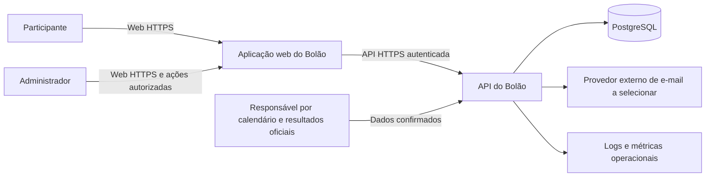
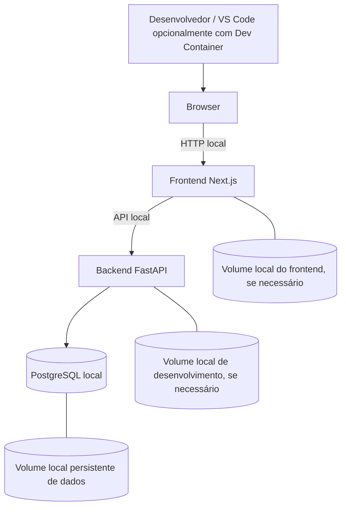

# Arquitetura de Software — Bolão da Copa do Mundo Feminina da FIFA Brasil 2027

**Versão:** 0.2 (proposta atualizada)  
**Elaboração:** 18/10/2026  
**Status:** Proposta para revisão; não aprovada para implementação.  
**Fonte primária do produto:** requisitos v3.1, de 18/10/2026.

> Este documento descreve decisões arquiteturais documentadas, mas não componentes implementados. As regras aprovadas permanecem na fonte de requisitos. O desenvolvimento será local via Docker Compose; implantação e operação em GCP estão fora do escopo. Pendências residuais estão centralizadas em `docs/requirements/decisoes-pendentes.md`.

## 1. Resumo executivo

A topologia de desenvolvimento definida é local, com Docker Compose e serviços separados para frontend Next.js/TypeScript, API FastAPI/Python e PostgreSQL, além de volumes locais para persistência durante o uso. O Dev Container no VS Code pode ser usado, mas não é obrigatório. Volumes locais não constituem backup.

A arquitetura deve facilitar portabilidade futura ao GCP, mas implantação e gerenciamento de recursos GCP não fazem parte do projeto. Não se prescrevem Cloud Run, Cloud SQL, CI/CD de produção, operação de nuvem, objetivos de recuperação nem serviços gerenciados como entregáveis.

As propriedades críticas permanecem integridade temporal e privacidade dos palpites, apuração idempotente, auditoria administrativa e ranking determinístico. Validações de domínio pertencem ao backend. Os modos de autenticação previstos são conta Google e identidade local, com detalhes de associação, sessão e recuperação ainda a especificar.

Não há código de aplicação, dependências, Compose, dados de partidas ou comandos de build/teste confirmados no repositório. Esta documentação não cria esses artefatos nem implementa funcionalidades.

## 2. Objetivo e escopo

Preparar decisões técnicas e um plano incremental para o produto definido em `docs/requirements/requisitos-bolao-copa-mundo-feminina-2027.md`. O produto atende um grupo único, sem ligas públicas ou multi-tenancy, para 32 seleções, 8 grupos e 64 partidas previstas entre 24/06 e 25/07/2027. Resultados são inseridos por administradores; API paga de resultados, vídeo e movimentação financeira estão fora do escopo aprovado.

Incluem-se decisões e recomendações de arquitetura para desenvolvimento local, segurança, persistência, testes e portabilidade. A implantação e gestão GCP não fazem parte do escopo. Não se incluem implementação, telas funcionais, endpoints, migrações, criação de infraestrutura ou scripts de deploy.

## 3. Fontes consultadas e hierarquia

### Fontes do projeto

1. `docs/requirements/requisitos-bolao-copa-mundo-feminina-2027.md`, versão 3.1, 18/10/2026 — fonte de verdade para regras do produto.
2. `docs/architecture/PROMPT-ARQUITETURA-CLAUDE-CODE.md` — instrução para esta proposta; não é aprovação de decisões técnicas.
3. `docs/requirements/decisoes-pendentes.md` — registro das decisões e lacunas residuais.
4. `openspec/config.yaml` e estrutura do repositório — fornecem configuração inicial `spec-driven`; OpenSpec é a ferramenta sugerida para apoiar o processo SDD leve, com governança manual, sem uso obrigatório.

### Precedência

Requisitos formalmente aprovados → decisões de produto confirmadas → decisões arquiteturais aprovadas → este documento e solicitações pontuais compatíveis → documentação técnica e boas práticas. Referências técnicas justificam implementação, nunca alteram regra de negócio.

### Referências técnicas consultadas em 18/10/2026

As páginas abaixo foram acessadas; os resumos referem-se ao conteúdo obtido nessa data. Não foram consultados preços nem feitas medições. Diferencie-se: **fato documentado** é conteúdo da fonte; **inferência** é consequência aplicada a este projeto; **recomendação** é proposta ainda sujeita a aprovação.

- Next.js Docs, incluindo [Server and Client Components](https://nextjs.org/docs/app/getting-started/server-and-client-components): App Router usa Server Components por padrão; Client Components são apropriados para estado, eventos e APIs de navegador. Módulos importados por Client Component integram seu grafo de cliente. (Fato.)
- [TypeScript Handbook](https://www.typescriptlang.org/docs/): documentação de tipos, funções, módulos e opções de compilador. (Fato; não determina arquitetura de aplicação.)
- [FastAPI](https://fastapi.tiangolo.com/): framework baseado em Starlette e Pydantic, validação/serialização tipada, OpenAPI, dependências, `APIRouter` e recursos de teste. (Fato.)
- [Python 3 Documentation](https://docs.python.org/3/): página acessada identificava documentação 3.15.0 e versão 3.16 em desenvolvimento. Isso não prova compatibilidade do ecossistema proposto; versão de Python permanece por selecionar. (Fato e limitação.)
- [PostgreSQL Documentation](https://www.postgresql.org/docs/current/): documentação consultada identificava PostgreSQL 18.6 e apontava capítulos de concorrência/controle transacional, constraints e tipos de data/hora. A página de conteúdo não foi usada para afirmar semânticas detalhadas de comandos. (Fato.)
- [SQLAlchemy 2.0](https://docs.sqlalchemy.org/en/20/): ORM e Core, sessões/conexões, transações e suporte assíncrono documentados. (Fato.)
- [Alembic](https://alembic.sqlalchemy.org/en/latest/): ferramenta de migração de banco associada a SQLAlchemy, com revisões e suporte a autogeração. (Fato.)
- [Google Cloud Well-Architected Framework](https://docs.cloud.google.com/architecture/framework): seis pilares — excelência operacional, segurança/privacidade/conformidade, confiabilidade, otimização de custos, desempenho e sustentabilidade. (Fato.)
- [Cloud Run](https://docs.cloud.google.com/run/docs): serviço gerenciado para workloads em contêiner, com escalabilidade e guias de autenticação/operação. [Cloud SQL for PostgreSQL](https://docs.cloud.google.com/sql/docs/postgres): banco PostgreSQL gerenciado, conectividade, alta disponibilidade, backup e recuperação. (Fatos.)
- [Secret Manager](https://docs.cloud.google.com/secret-manager/docs): armazenamento e controle de acesso IAM para dados sensíveis; a página acessada não descreveu identidade de workload. (Fato e limitação.)
- [OWASP ASVS](https://owasp.org/www-project-application-security-verification-standard/): framework de requisitos para verificar controles de segurança de aplicações web; a página mostrava v5.0.0. [OWASP API Security](https://owasp.org/www-project-api-security/): projeto mantém Top 10 e boas práticas, mas a página acessada não identificava a edição atual. (Fatos; não se declara conformidade.)
- [Claude Code Overview](https://code.claude.com/docs/en/overview): documentação descreve `CLAUDE.md` de projeto como arquivo de instruções persistentes lido no início da sessão. (Fato.)
- [OpenSpec](https://github.com/Fission-AI/OpenSpec): README apresenta fluxo spec-driven com proposta, especificações, design e tarefas, seguidos de aplicação e arquivamento. O repositório contém scaffold local, mas sua configuração não registra regras específicas do produto. (Fato.)

Não foram acessadas páginas específicas de versões suportadas, preços, Cloud SQL conexão privada/IAM, critérios atuais do OWASP API Top 10, política de suporte ou detalhes de recuperação. Validar essas matérias antes de fechar versões, orçamento ou desenho de rede.

## 4. Requisitos arquiteturalmente relevantes

### Funcionais

- Cadastro, autenticação, alteração e recuperação de senha por e-mail, com token único de duração entre 30 e 60 minutos conforme regra aprovada e resposta que não revela se o e-mail está cadastrado.
- Palpites inteiros não negativos, editáveis até uma hora antes do início oficial; requisições recebidas no corte/depois são rejeitadas, embora as recebidas antes possam concluir depois; palpites ficam visíveis após o corte a participantes comuns.
- Administração de calendário, seleções/classificação de mata-mata, resultados oficiais e correções auditáveis.
- Pontuação 6/3/2/1/0, explicação de pontos, ranking com quatro critérios além de pontos totais, visão rodada a rodada, grupos/chaveamento, estatísticas/badges e chamados de suporte.

### Não funcionais / qualidade

- Integridade temporal e concorrente do corte; autorização consistente em qualquer rota/consulta.
- Cálculo determinístico, auditável e idempotente após correção de resultado.
- Confidencialidade de palpites e dados pessoais antes/de acordo com a regra; não há compromisso de backup/recuperação; riscos e limitações devem ser comunicados.
- Baixa complexidade operacional, testabilidade, acessibilidade, responsividade e rastreabilidade.

## 5. Restrições e premissas

- Grupo único; não adicionar tenant/ligas independentes.
- Stack conceitual: Next.js/TypeScript, FastAPI/Python e PostgreSQL; versões continuam por selecionar. Execução local com Docker Compose está definida. Portabilidade a GCP é uma meta, não compromisso de deployment ou operação.
- Nenhum código fonte, manifesto de dependências, README, configuração de build, CI ou dado oficial de partidas foi encontrado. Não existem comandos de build/teste confirmados.
- OpenSpec possui configuração `schema: spec-driven` e é a ferramenta sugerida para apoiar o processo SDD leve; sua utilização não é obrigatória, a governança permanece manual e o checklist ainda será detalhado.
- Requisito define BRT como UTC-3 permanente e todas as exibições neste fuso. Recomenda-se armazenar instantes em UTC e apresentar com offset fixo UTC-03:00 conforme requisito; mudanças oficiais de calendário devem ser atualizações de dados auditáveis, não suposições em código.
- Não se assume volume de usuários, orçamento, disponibilidade, residência de dados, fornecedor de e-mail ou equipe de operação. Não há backup/recuperação no escopo decidido.

## 6. Definidas versus pendentes

### Definido na fonte de requisitos

As regras de pontuação e precedência, placar de mata-mata ao final de 120 minutos, pênaltis não incorporados, janela de uma hora, regra de recepção do requisito v3.1, publicação dos palpites após o corte, 7 rodadas, desempates, grupo único e escopo excluído são requisitos. Recuperação por token único de 30 a 60 minutos e resposta anti-enumeração também estão definidos. Não os flexibilizar por conveniência técnica.

### Recomendação arquitetural (não aprovada)

Monólito modular no backend; frontend, API e PostgreSQL em serviços locais separados via Compose; cálculo por casos de uso idempotentes, dados oficiais versionados/auditados e projeções derivadas substituíveis. Não introduzir fila/cache/microserviços sem necessidade mensurável.

### Pendências de negócio e operação

Ver seção 22. As recomendações são propostas para decisão, não regras vigentes. Impedem iniciar somente os fluxos cujo comportamento depender delas; decisões de versão, hospedagem e custo bloqueiam o fechamento da arquitetura operacional, não necessariamente protótipos isolados.

## 7. Atributos de qualidade e prioridades

1. **Integridade e justiça:** mesma regra e mesmo instante autoritativo para todas as gravações; resultados e cálculos reproduzíveis.
2. **Confidencialidade:** palpites não são recuperáveis por participante alheio antes do corte, inclusive por APIs alternativas, cache, logs ou consultas agregadas.
3. **Auditabilidade:** autor, momento, motivo e valores anteriores/novos de ações administrativas; capacidade de reproduzir projeções.
4. **Simplicidade operacional:** um backend modular, um banco gerenciado e sem infraestrutura distribuída prematura.
5. **Testabilidade:** regras puras isoladas de HTTP/ORM; testes integrados com PostgreSQL para semântica transacional.
6. **Usabilidade inclusiva:** interfaces responsivas, acessíveis, com erros e prazos explícitos; datas sempre no fuso definido.
7. **Evolução segura:** mudanças de requisitos e schema revisadas e migradas incrementalmente.

## 8. Visão arquitetural geral

### Diagrama de contexto



### Topologia de desenvolvimento local definida



A topologia representa serviços separados via Docker Compose para frontend, backend e banco. Os volumes locais servem à persistência do ambiente de desenvolvimento/testes; políticas exatas de montagem, nomes e ciclo de vida serão definidas ao criar a configuração, que não faz parte desta atualização documental. O volume do banco preserva dados entre reinicializações normais, mas não protege contra exclusão, corrupção ou perda do armazenamento e não é backup.

GCP é somente um possível destino de portabilidade. Não há diagrama de produção aprovado nem atividade de implantação/gestão GCP prevista nesta arquitetura.

## 9. Arquitetura escolhida e alternativas

**Proposta:** monólito modular no serviço Python, executado localmente como serviço de backend separado do frontend e do PostgreSQL via Docker Compose. Módulos compartilham deployment do backend e banco, mas cada dado tem autoridade e dependências explícitas. Casos de uso atravessam módulos por interfaces internas ou serviços de aplicação; não se introduz RPC interno.

**Por quê:** escala e operação de um grupo único não justificam microserviços. Uma transação PostgreSQL simplifica a gravação de palpite/corte, registro oficial/auditoria e publicação consistente de apuração. Frontend separado permite executar UI e API em serviços distintos localmente, conforme decisão TEC-02, sem particionar artificialmente o domínio.

**Alternativas consideradas:**

- Next.js full-stack como backend único: menor número inicial de serviços, mas conflita com a direção FastAPI/Python e divide regras entre runtimes. Poderá ser reconsiderado se a equipe escolher um stack único antes da implementação.
- Frontend e API no mesmo processo/deployment: menor custo/complexidade inicial, mas acopla escalabilidade, exposição e release; pode ser apropriado em hospedagem restrita. Não se assume compatibilidade de execução Next.js com o destino sem validar.
- Microserviços/eventos/filas: isolamento e escala independentes, mas acrescentam consistência eventual, operação e observabilidade sem necessidade demonstrada. Não recomendado inicialmente.
- Portabilidade GCP: serviços gerenciados podem ser avaliados futuramente como destino por quem vier a operar o sistema. Esta equipe não selecionará nem implantará hospedagem GCP; scripts de portabilidade ainda não foram decididos.

## 10. Módulos de domínio e dependências

Cada módulo controla suas invariantes e expõe casos de uso/contratos. As fronteiras são propostas de organização, não microserviços.

| Módulo | Autoridade e responsabilidades | Casos de uso principais | Dependências permitidas / proibidas |
|---|---|---|---|
| Identidade e acesso | Identidade de participante, credenciais, sessão e papéis | Cadastro/entrada conforme política; login; troca/recuperação de senha; autorização | Pode ser consultado por todos via interfaces de identidade; não depende de Palpites ou Ranking. Não expõe senha/token. |
| Torneio e calendário | Seleções, grupos, rodadas, partidas, horários, estado de calendário e chaveamento | Publicar/alterar calendário; registrar classificação e confrontos | Não depende de pontuação. Fornece partida e versão/estado a Palpites e Administração. |
| Palpites | Um palpite por participante-partida, valor, momento de gravação e regra de abertura/visibilidade | Criar/editar, consultar próprio, consultar grade após corte | Consulta calendário para prazo; consulta Identidade para escopo; não lê diretamente tabelas de outros módulos. |
| Resultados oficiais e auditoria | Resultado de 120 min e revisões administrativas; trilha de alterações | Lançar/corrigir resultado, apurar e solicitar recálculo | Consulta partida; chama Apuração em transação/orquestração; auditoria registra ação/ator. Não altera palpites. |
| Apuração e pontuação | Função de pontuação pura e resultado calculado por palpite/versão de resultado | Calcular/recalcular, explicar pontuação, registrar versão do cálculo | Recebe palpites/resultados por contratos; não decide calendário nem identidade. Idempotência por chaves naturais/versões. |
| Ranking e estatísticas | Agregados e projeções por participante/rodada | Consultar ranking e histórico; explicar desempate; atualizar projeções | Consome dados de apuração e participantes; não muda resultados. Projeção reconstruível. |
| Suporte | Chamados, protocolo, estado e respostas | Abrir, consultar e administrar chamado | Consulta identidade; acesso restrito ao chamado. Retenção pendente. |
| Gamificação | Definições e concessões de badges após critérios aprovados | Calcular concessão e exibir badges | Depende de métricas de apuração/ranking por interface; não altera pontos. Usar a proposta `docs/requirements/PROD-06-criterios-badges-gamificacao.md`, que aguarda aprovação do responsável pelo produto; concessão automática permanece bloqueada até essa aprovação. |

### Regras de dependência

- Domínio não importa FastAPI, SQLAlchemy, SDK de e-mail, Cloud SDK ou componentes de UI.
- Aplicação orquestra domínio e portas de persistência/relógio/e-mail; adaptadores HTTP, SQL e provedores implementam portas.
- Dependências direcionam-se para regras de domínio; módulos não leem/escrevem tabelas alheias diretamente.
- HTTP valida sintaxe/autenticação e mapeia erros; domínio/aplicação impõem invariantes. DB reforça unicidade e integridade.
- Leitura otimizada pode usar consultas/projeções específicas, sem permitir que UI bypass autorização.

## 11. Backend Python/FastAPI

Estrutura conceitual (nomes propostos; sem arquivos criados):

```text
backend/
  app/
    entrypoints/http/        # FastAPI, routers, schemas de transporte, middleware
    modules/
      identity/{domain,application,adapters}
      tournament/{domain,application,adapters}
      predictions/{domain,application,adapters}
      scoring/{domain,application,adapters}
      ranking/{domain,application,adapters}
      administration/{domain,application,adapters}
      support/{domain,application,adapters}
      gamification/{domain,application,adapters}
    shared/                  # primitives realmente comuns, clock, IDs, erros
    bootstrap/               # composição/configuração por ambiente
  tests/{unit,integration,api,contract}
```

- **Domínio:** objetos/valores e políticas puras (pontuação, estado de janela), sem ORM nem framework.
- **Aplicação:** casos de uso e limites transacionais (gravar palpite, alterar calendário, lançar resultado, recalcular, consultar ranking); define portas.
- **Entrada:** routers FastAPI e modelos Pydantic adaptam HTTP aos casos de uso. Erros de domínio têm mapeamento uniforme e mensagens sem dados sensíveis.
- **Saída:** repositórios SQLAlchemy, e-mail, relógio e observabilidade implementam portas. Alembic mantém revisões versionadas; avaliar autogeneração, revisar manualmente, testar upgrade e downgrade em ambiente descartável antes de adotar.
- **Persistência:** SQLAlchemy 2.x é recomendação inicial; escolher síncrono ou assíncrono após prova de compatibilidade e perfil. Não misturar estilos de sessão. Sessões/transações com escopo explícito por caso de uso.
- **Validação:** Pydantic/HTTP valida forma/tipo; domínio valida regras, incluindo gols como inteiros não negativos. Constraints do banco protegem invariantes concorrentes.
- **Erros:** contrato estável (código e mensagem segura), sem revelar detalhes internos; exceções técnicas são observadas internamente sem PII/senhas/tokens.
- **Configuração:** variáveis não secretas por ambiente; segredos via gerenciador aprovado. Falha segura se configuração essencial faltar; nunca valores secretos em frontend.
- **Observabilidade:** logs estruturados com correlation/request ID, ator pseudônimo/ID interno quando necessário, evento operacional e resultado; métricas para latência/erros, gravações rejeitadas por prazo, apurações e falhas. Redigir e limitar dados sensíveis.

A escolha de FastAPI não desloca regras para dependências HTTP; serviços de domínio e casos de uso podem ser testados sem levantar servidor.

## 12. Frontend Next.js/TypeScript

Organização conceitual:

```text
frontend/
  app/                       # rotas, layouts, loading/error/not-found
  features/                  # auth, tournament, predictions, ranking, admin, support
  components/                # componentes acessíveis reutilizáveis
  lib/api/                   # cliente tipado, serialização, erros e sessão
  lib/dates/                 # formatação do horário BRT (UTC-03:00)
```

- Preferir App Router e Server Components para renderização/leitura segura quando a topologia permitir. Manter componentes de cliente pequenos, apenas para formulário, contador, interações e APIs do navegador. Nunca serializar em props dados privados alheios ao usuário.
- Não considerar Server Component/RSC mecanismo de autorização. API aplica autorização em toda requisição; cache de respostas autenticadas/grades de palpites deve ser desabilitado ou segregado de forma comprovada para impedir vazamento entre usuários/estados.
- A sessão deve usar cookie `HttpOnly`, `Secure`, `SameSite` adequado e proteção CSRF quando aplicável, ou fluxo equivalente decidido após análise de ameaça. Nunca persistir bearer tokens sensíveis em `localStorage` sem decisão de segurança explícita. Detalhes de sessão, associação de contas e compatibilidade do reset com contas Google permanecem pendentes (TEC-01).
- Chamada de API centralizada, tipos de contrato e mapeamento de erro previsível. Estados explícitos de carregamento, erro, vazio e sucesso. Formulário valida no cliente por UX e no backend por segurança.
- Estado local para interações; não adotar store global sem necessidade comprovada. Dados autoritativos sempre carregados da API.
- Datas formatadas com UTC-03:00 conforme requisito, sem confiar no timezone do dispositivo. Contador é informativo; servidor decide corte.
- Acessibilidade: navegação por teclado, rótulos e erros associados, contraste, foco visível, sem usar apenas cor, layouts responsivos e testes com tecnologia assistiva.
- Testes de componentes e fluxos críticos; contrato da API compartilhado/validado sem duplicar regra de negócio.

## 13. Modelo conceitual de dados

Modelo lógico inicial; não equivale a schema aprovado nem migração.

- **Participant/User:** ID estável, nome de exibição, e-mail normalizado, estado de conta; papéis/atribuições administrativas controladas. Separar identidade externa se houver provedor externo. Senhas guardadas apenas como hash adaptativo com salt; política criptográfica validada na implementação.
- **Tournament:** edição/título do torneio e timezone de apresentação fixa; **Team/Selection** associada ao torneio; **Group** e associação de seleções; o calendário oficial é dado administrado e versionável.
- **Round:** uma das sete rodadas aprovadas. **Match:** identificador, rodada, fase, seleções/slots de chaveamento, kickoff UTC, apresentação conforme BRT, estado (incluindo cancelada/anulada) e versão de calendário. A tabela de confrontos e equipes oficiais ainda não existe neste repositório; atualização manual por administrador com auditoria está decidida (OPS-06).
- **Prediction:** participante, partida, gols inteiros não negativos, criado/atualizado em UTC e, se necessário, versão/autor da alteração. Restrição única `(participant_id, match_id)`; constraint para gols >= 0. A janela não se resolve com constraint estática. Validação considera timestamp de recepção confiável gerado pelo servidor; pedidos recebidos antes do corte podem concluir depois (PROD-01).
- **OfficialResult/ResultRevision:** partida, placar de 120 minutos, estado de apuração, autor, momento e revisão. Tratar valores de pênaltis separadamente apenas se houver necessidade de exibição; não entram na função de pontuação. Correções administrativas são sempre permitidas com revisão e auditoria (PROD-04); o estado/mensagem de encerramento da apuração ainda precisa de definição.
- **ScoreCalculation:** palpite, revisão do resultado e versão do algoritmo, pontos e categoria explicativa. Chave única por palpite+revisão+versão torna repetição idempotente; alternativa é substituir projeção vigente mantendo evento histórico. Decidir retenção/volume ao projetar.
- **RoundRankingSnapshot/RankingProjection:** rodada, versão de cálculo, participante, totais e métricas de desempate, opcionalmente fotografia. Deve ser reconstruível a partir de dados fonte e cálculos; não assumir um snapshot imutável antes de definir desempate parcial.
- **PasswordResetToken:** digest do token (não token em claro), participante, emissão/expiração, utilizado/revogado; uso único com consumo atômico.
- **SupportTicket/Reply:** protocolo, solicitante, estado, mensagens e timestamps; política de exposição/retention pendente.
- **AuditEvent:** ator, ação, recurso, timestamp UTC, correlação, motivo e diff mínimo necessário. Não guardar segredos nem duplicar PII sem finalidade.
- **BadgeDefinition/BadgeGrant:** regras aprovadas e concessão por participante; revogação/recalculo pendentes.

### Integridade e índices candidatos

- FKs com política explícita de exclusão; não inferir deleção em cascata: escopo de exclusão por tipo de dado e preservação de histórico permanecem pendentes (OPS-01).
- Unicidade de palpite por participante-partida, chave única de cálculo, IDs não sequenciais expostos publicamente, checks de placares inteiros >= 0.
- Índices para partida por kickoff/rodada, palpites por partida (consulta pós-corte) e por participante, resultado por partida/revisão, ranking por rodada/participante, suporte por status/solicitante e auditoria por recurso/tempo.
- Instantes armazenados em UTC em tipos timezone-aware; formatar como BRT no limite de apresentação. Horário oficial original/offset e revisões podem ser preservados para auditoria, sem misturar texto local e instante.
- Migrações incrementais, revisadas e testadas em cópia não produtiva. Não editar migrações já aplicadas; preparar migrações de expansão/contração quando houver deployment concorrente. Backup/restore não fazem parte do escopo decidido (OPS-02); compatibilidade de schema continua sendo requisito de mudança.
- Não há prazo de retenção nem exclusão automática. Usuário ou administrador podem excluir, mas escopo e impacto sobre histórico/auditoria permanecem pendentes (OPS-01). Não há backup nem recuperação no escopo (OPS-02).

## 14. Autenticação e autorização

- Cadastro é aberto, mas requer aprovação administrativa; após aprovação há e-mail de confirmação/liberação. Campos mínimos definidos: nome e e-mail (PROD-07). Usar um papel administrador com privilégios mínimos necessários (PROD-08); fluxo e matriz operacional detalhados permanecem pendentes.
- Suportar autenticação por conta Google ou identidade local (usuário/senha), sem decisão de fluxo padrão/associação entre contas; TLS obrigatório em produção. Armazenar senha com hash adaptativo aprovado (parâmetros a confirmar na data da implementação), política de recuperação segura, rate limit e reautenticação para ações críticas.
- Recuperação: resposta idêntica e temporalmente semelhante para e-mail existente/inexistente; token aleatório de alta entropia, só digest armazenado, uso único, curta expiração dentro dos 30–60 min definidos, invalidar após uso/alteração, limitar tentativas e não registrar token. Envio assíncrono só após decisão se houver fila; uma chamada simples pode servir ao porte inicial.
- A autorização é aplicada no backend a cada recurso e ação. Participante acessa/edita o próprio palpite enquanto a requisição for recebida antes do corte vigente; a grade de palpites de todos fica disponível somente após o corte. Não há exceção administrativa individual para alteração pós-corte; pedidos de suporte não alteram palpites. Uma alteração oficial do kickoff recalcula o corte e pode reabrir a janela para todos, conforme PROD-02/05. Administrador tem privilégios mínimos para calendário/resultados/suporte.
- Um único papel administrador com privilégios mínimos necessários; proteger ações administrativas, aplicar autorização no backend e auditar alterações. Os participantes comuns não veem palpites alheios antes do corte; não presumir bypass administrativo de visibilidade.
- Administração protegida com autenticação forte apropriada e proteção contra CSRF em sessão baseada em cookie.
- Sessões com expiração, revogação e renovação definidas; cookies HttpOnly/Secure/SameSite são recomendação se sessão web própria. Detalhes e provedor pendentes.

## 15. Segurança, privacidade e auditoria

### Obrigatório pela regra de produto

- Bloquear leitura de palpites alheios antes do corte no backend; rejeitar escritas cuja recepção confiável ocorra no corte ou depois, permitindo concluir após o corte apenas requisições recebidas antes dele; impedir participante comum de obter dados por rotas alternativas.
- Proteger contas e recuperação sem revelar existência de e-mail; segregar administração e registrar correções de resultados.
- Evitar exposição de segredos e dados pessoais desnecessários.

### Controles recomendados

- TLS; IAM e service accounts com privilégio mínimo; Secret Manager (ou equivalente aprovado); banco não exposto diretamente à internet; validação de entrada e queries parametrizadas; proteção CSRF/XSS, CORS allowlist estrita, headers de segurança e política de conteúdo adequadas à UI.
- Rate limit de login/recuperação e ações de escrita; detecção de abuso, CAPTCHA apenas se ameaça justificar; segurança de sessão e rotação de segredos.
- Logs sem senhas, tokens, conteúdo integral de e-mail/chamado, palpite confidencial ou dados pessoais desnecessários. Controle de acesso; o prazo de retenção dos próprios logs não está definido (OPS-01).
- Revisão de dependências, atualizações, análise de vulnerabilidades, SAST/DAST conforme capacidade, revisão de permissões, controles de segurança proporcionais ao ambiente local; sem declarar recuperação/backups.
- Usar OWASP ASVS como checklist e OWASP API Security para ameaças de autorização, autenticação, abuso e consumo de recursos; selecionar nível/controles após avaliação de risco. Nenhuma certificação/conformidade é declarada.
- Auditoria append-only lógica, limitada a dados necessários e protegida contra alteração por rotas comuns. Cada resultado corrigido gera evento contendo ator, momento, partida, antes/depois e motivo obrigatório (motivo deve ser confirmado como requisito operacional).
- Não se configura backup nem recuperação neste escopo (OPS-02). Volumes locais não são backup; qualquer futura alteração de escopo deve primeiro reabrir essa decisão.

### Dependente de decisão

Escopo e efeitos de exclusão/anonimização, visibilidade administrativa pré-corte, MFA, associação das contas Google e locais, localização/região de dados, prazo de retenção de logs, resposta a incidentes e classificação de dados. O modo de autenticação Google/local está definido como capacidade requerida (TEC-01), não como escolha de provedor ou fluxo. Não alegar requisitos legais específicos sem determinar jurisdição e análise aplicável.

## 16. Palpites, corte e visibilidade

**Regra aprovada:** o corte é uma hora antes do kickoff oficial vigente. O backend valida o timestamp confiável de recepção: pedidos recebidos antes do corte podem concluir depois; recebidos no instante do corte ou depois são rejeitados. Após o corte, palpites tornam-se visíveis na partida. Alteração oficial do kickoff recalcula o corte e pode reabrir a janela (PROD-01/02).

**Proposta técnica para corte:** uma única regra compartilhada no domínio/aplicação calcula `cutoff = scheduled_kickoff_utc - 1 hour`; o banco guarda instantes UTC; a avaliação final usa relógio confiável do servidor, não relógio do navegador. Serializar mudança de palpite e mudanças de kickoff pela mesma linha/controle da partida (por exemplo, lock transacional da partida); após obter o lock, ler a versão vigente do kickoff e reavaliar o prazo junto da escrita. A condição é `received_at < cutoff`; requisição elegível pode concluir após o corte, com timestamp confiável preservado para auditoria. O cutoff é sempre recalculado sobre o kickoff oficial vigente; alteração oficial pode reabrir a janela (PROD-02). O timestamp usado pelo banco e a noção de “requisição recebida” precisam ser definidos e testados conforme semântica real do driver/banco na implementação.

**Visibilidade:** endpoint de consulta verifica estado e hora do servidor em cada chamada; antes do corte responde sem palpites alheios (não apenas ocultação na UI). Depois, lista apenas os dados permitidos. Respostas privadas não podem ser compartilhadas em cache/CDN. Administrador não deve ter bypass pré-corte por padrão; não há exceção administrativa individual para alterar palpites após o corte (PROD-05). A alteração oficial do kickoff pode recalcular o corte e reabrir a janela para todos (PROD-02), conforme decisão registrada e requisito v3.1.

**Concorrência:** duas edições do mesmo palpite devem ter política de conflito explícita. Recomendação: lock/versionamento otimista e última atualização válida vence apenas se a revisão esperada coincidir; caso contrário responder conflito e pedir recarga. O corte e o calendário devem ser rechecados dentro da transação. A semântica de produto está definida em PROD-01; permanece pendente a forma técnica de provar e preservar o timestamp confiável de entrada.

## 17. Pontuação, recálculo e ranking

### Pontuação

A fonte define explicitamente cálculo decrescente e excludente. Interpretação de referência: classificar resultado de cada placar na ordem 6, 3, 2, 1, 0; “gols de 1 equipe” é **exatamente uma** equipe nos casos de 3 e 1 pontos. A regra 6 prevalece quando ambos acertam. Tabela de exemplos abaixo usa resultado oficial **2–1** (casa–fora):

| Palpite | Resultado geral correto? | Gols exatos | Pontos | Justificativa |
|---|---:|---|---:|---|
| 2–1 | Sim | ambos | 6 | Placar exato, precedência máxima |
| 2–0 | Sim | casa | 3 | Vitória e gols de exatamente uma equipe |
| 3–1 | Sim | fora | 3 | Vitória e gols de exatamente uma equipe |
| 3–0 | Sim | nenhum | 2 | Vitória, erra ambos os gols |
| 0–1 | Não | fora | 1 | Palpite de vitória visitante; acerta um total de gols |
| 2–2 | Não | casa | 1 | Palpite de empate; acerta exatamente um total |
| 0–0 | Não | nenhum | 0 | Nenhuma categoria anterior |

Com placar oficial **1–1**: 1–1 = 6; 2–1 = 1 (resultado errado, gols visitantes certos); 0–0 = 2 (empate, ambos totais errados); 1–2 = 1 (resultado errado, gols da casa certos); 0–2 = 0. Assim, categorias são mutuamente exclusivas; a interpretação aplicada é exatamente uma equipe nas categorias de 3 e 1 ponto, respeitando a precedência do placar exato. Casos unitários parametrizados devem cobrir todos os resultados W/D/L e acertos de zero gols.

Para eliminatórias, resultado usado é placar ao término dos 120 minutos, incluindo prorrogação; pênaltis são excluídos e empate permanece empate. O administrador cadastra placar final de 120 minutos. Jogo adiado mantém palpites e novo kickoff; jogo cancelado/anulado é excluído da pontuação (PROD-03). Tratamento de partidas suspensas/abandonadas e efeitos em ranking/badges permanece pendente.

### Recálculo

Manter dados oficiais e palpites como fontes; pontuação/ranking são derivados. Ao publicar/corrigir resultado, em uma transação persistir revisão imutável do resultado e evento de auditoria; recalcular todos os palpites elegíveis para aquela partida, chaveando por palpite + revisão do resultado + versão de regra. O mesmo comando repetido sobre as mesmas entradas deve produzir os mesmos registros (upsert/substituição determinística, sem somar pontos incrementalmente). Recalcular projeção do ranking afetada a partir de scores por partida; publicar versão completa atomicamente para leitores ou recomputar consulta, evitando ranking parcialmente atualizado. Escolha entre cálculo síncrono na transação e job durável depende do volume/necessidade operacional; para 64 jogos e grupo único, começar síncrono é recomendação, desde que limites de latência sejam medidos e a transação seja testada. Não adicionar fila antes de necessidade.

Se transação extensa causar bloqueios, registrar revisão oficial e cálculo pendente com estado explícito, preservar ranking anterior identificado como defasado e publicar nova versão atômica ao completar; isso exige decisão de apresentação e não deve ser simulado como “tempo real”. Resultado corrigido invalida/reconstrói derivados, não apaga trilha de eventos.

### Ranking

Ordenação aprovada:
1. pontos totais DESC;
2. quantidade de palpites de 6 pontos DESC;
3. quantidade de palpites de 3 pontos DESC;
4. pontos acumulados em rodadas anteriores DESC, ignorado em R1;
5. nome de exibição normalizado, sem acentos e sem diferença entre caixa, ASC.

Armazenar pontuação por participante/partida/versão; agregar por rodada; manter snapshots/projeções reconstruíveis por versão do resultado/cálculo. Não usar ordem de consulta não determinística: calcular chave normalizada com normalização Unicode e regra de locale estável; se todos os critérios de negócio forem iguais, apresentar empate. ID estável pode ordenar linhas tecnicamente de forma repetível sem alterar a classificação oficial.

O documento de requisitos já define os critérios de desempate e determina que a fórmula seja recalculada a cada partida apurada. Portanto, “rodadas anteriores” não é uma decisão de negócio em aberto: a partir da Rodada 2, aplica-se a pontuação acumulada nas rodadas anteriores à rodada em avaliação; na Rodada 1, ignora-se esse critério. O ranking corrente usa os resultados oficialmente apurados até então e não inclui pontuação de partidas ainda sem apuração. A apresentação pode indicar progresso/partidas pendentes para deixar claro que os dados ainda estão sendo apurados; isso não altera a regra de ordenação.

**Pendência limitada à apresentação:** decidir se a interface deve exibir explicitamente estado de apuração/progresso da rodada ou apenas os totais atuais. Correções de resultados de rodadas anteriores devem recalcular as pontuações derivadas e os rankings afetados, preservando a ordem de desempate já aprovada; não constituem mudança dos critérios.

## 18. Transações, concorrência e idempotência

- **Salvar palpite:** autenticar/autorização; obter timestamp confiável de recepção; transação, lock/versão da partida, leitura do horário vigente; validar `received_at < cutoff`; inserir/atualizar com unique `(participant, match)` e conflito de versão; commit. Requisições recebidas antes do corte podem concluir depois dele; requisições recebidas no corte ou após são rejeitadas.
- **Mudar calendário:** somente administrador; persistir revisão, ator e timestamp; serializar com gravações/leituras afetadas; invalidar caches. O cutoff acompanha o kickoff oficial vigente e pode reabrir (PROD-02); versionar a mudança e auditar as operações afetadas.
- **Resultado:** revisão oficial e evento de auditoria atômicos; cálculo depende da revisão identificada; constraint/unique protege reexecução; ranking recalculado como projeção identificada e publicado inteiro.
- **Consulta durante recálculo:** ler versão completa anterior enquanto nova se constrói, ou aguardar commit síncrono; nunca combinar totais velhos e novos. Expor data/versão de atualização se houver defasagem aprovada.
- **Reexecução:** mesmo resultado, palpites e algoritmo → mesma pontuação. Uma nova revisão de resultado ou versão de regra é nova entrada e gera nova projeção/revisão, sem duplicar acumulados.
- **Isolamento:** preferir transações curtas com constraints explícitas; testar integração em PostgreSQL real. Escolher isolamento/locking após prova de concorrência, não assumir que testes SQLite representam semântica PostgreSQL.

## 19. Testes e critérios de qualidade

Pirâmide recomendada:

1. **Unitários:** funções de pontuação e normalização; estados de janela; expiração/uso único de token; tabela parametrizada dos casos e limites; timezone e arredondamento/inteiros.
2. **Casos de uso:** autorização, respostas anti-enumeração, criação/edição, revisão de calendário, auditoria e apuração idempotente com portas fakes/clock controlado.
3. **Integração PostgreSQL:** constraints, transações, locks/conflitos, cutoff concorrente, recuperação, migrações e consulta de ranking atômica.
4. **API/contrato:** esquema OpenAPI, status e erros, autorização por rota, ocultação pré-corte contra acesso direto, abuso/rate limits e não exposição de campos internos.
5. **Frontend:** estados de carregamento/erro/vazio, formulário acessível, formatação BRT e fluxo de login/palpite/consulta pós-corte/admin.
6. **E2E:** cadastro/entrada conforme regra, recuperar senha, aceitar requisição recebida antes do corte mesmo que conclua depois, rejeitar requisição recebida no corte ou após, visibilidade pós-corte, lançamento/correção de resultado, placar 120 min e ranking.
7. **Operacional/manual:** teste com responsáveis de conteúdo/calendário, navegação assistiva em browsers acordados, homologação de regras de negócio e ensaio de resposta a incidente. Teste de restauração não é critério deste escopo, pois backup/recuperação não estão previstos (OPS-02).

Critérios automáticos: nenhum acesso alheio antes do corte; rejeitar requisições cuja recepção confiável ocorra no corte ou depois, e aceitar conclusão posterior apenas para requisições recebidas antes; uma única pontuação por regra; recálculo repetido não duplica nem diverge; ranking respeita cada chave; migrations sobem em DB descartável; testes de autorização negativos. Critérios manuais: entendimento das regras, exatidão do calendário oficial, UX/acessibilidade, revisão de badges, e processos administrativos/recuperação.

Tecnologias de teste não estão escolhidas. Não há testes implementados nem comandos de execução confirmados.

## 20. Execução local e portabilidade

### Desenvolvimento local

A execução de desenvolvimento definida é Docker Compose com frontend, backend e banco em serviços separados. O banco usa volume local persistente para dados de desenvolvimento/teste; outros volumes só serão montados quando necessários ao fluxo. Dev Container no VS Code é opcional. A configuração Compose e imagens não foram criadas nesta atualização.

Os serviços locais devem manter fronteiras que facilitem substituição/portabilidade futura: configuração por ambiente, aplicação sem dependência de caminhos locais, banco acessado apenas pelo backend e segredos fora de imagens/repositório. Nenhuma dessas diretrizes equivale a criar deployment.

### GCP fora do escopo operacional

GCP é apenas um possível destino para o qual se deseja facilitar portabilidade. Não faz parte do projeto implantar ou gerenciar serviços GCP; Cloud Run, Cloud SQL, Secret Manager e Cloud Logging são referências possíveis, não arquitetura de produção aprovada. Scripts de geração/deploy para GCP não foram decididos e não serão criados nesta tarefa.

### Backup e recuperação

Não haverá necessidade/compromisso de backup ou recuperação no escopo definido (OPS-02); não declarar RPO/RTO, restore testado ou retenção de cópias. Um volume local do Compose é persistência operacional do ambiente, não backup. Qualquer futura mudança para operação GCP exigiria reavaliar explicitamente essa decisão antes de criar recursos ou afirmar recuperação.

### Custos e operação

Não há orçamento ou compromisso de operação GCP. Serviços locais usam recursos da máquina de desenvolvimento; disponibilidade, capacidade e gestão do ambiente local não têm metas formalizadas. Avaliações futuras de GCP são externas ao escopo atual.

## 21. Configuração, segredos e observabilidade

Configuração por ambiente validada na inicialização; segredos consultados em runtime com identidade do workload, acesso mínimo e rotação; variáveis prefixadas para cliente nunca contêm segredos. Logs estruturados com IDs de correlação e timestamp UTC; métricas técnicas e de processo sem dados pessoais; alertas acionáveis e runbooks. Não foi definido prazo de retenção de logs (OPS-01); não estabelecer retenção ilimitada por inferência. Não registrar palpite antes do corte em logs, traces, eventos ou analytics.

## 22. Decisões pendentes

O registro central e vigente de decisões pendentes é [`../requirements/decisoes-pendentes.md`](../requirements/decisoes-pendentes.md). Ele organiza as lacunas por domínio, registra recomendações ainda não aprovadas e identifica responsáveis e bloqueios; deve ser atualizado quando decisões forem aprovadas. Esta arquitetura não mantém uma lista paralela para evitar divergência entre documentos.

As decisões fornecidas estão registradas em `../requirements/decisoes-pendentes.md`. Permanecem lacunas: detalhes técnicos da recepção confiável (PROD-01), casos residuais de mudança de kickoff (PROD-02), partidas suspensas/abandonadas e exclusão de canceladas no ranking (PROD-03), estado de apuração e autorização (PROD-04), fluxo de admissão e exclusão (PROD-07/OPS-01), aprovação do catálogo de badges (PROD-06), fornecedor de e-mail (OPS-03), detalhes locais/portabilidade (TEC-02), autenticação/sessão (TEC-01) e checklist leve SDD (TEC-03).

Não há exceção administrativa individual pós-corte. Requests recebidos no corte/depois são rejeitados; requests recebidos antes podem concluir após o corte conforme timestamp confiável (PROD-01). Se o kickoff oficial mudar, o corte recalcula e a janela pode reabrir (PROD-02/05). Pontuação, placar válido no mata-mata, visibilidade pós-corte e critérios/ordem de desempate estão definidos no requisito e não são pendências.

## 23. Riscos técnicos e mitigação

| Risco | Consequência | Mitigação proposta |
|---|---|---|
| Apuração incompleta sem indicação na interface | Participante pode interpretar totais atuais como definitivos | Exibir estado/progresso de apuração; manter a regra de desempate aprovada |
| Corrida no corte ou alteração de kickoff | Palpite aceito tarde, recusado injustamente ou revelado | PROD-01/02; relógio único, lock/versionamento, testes reais PostgreSQL |
| Vazamento pré-corte por cache/consulta alternativa | Perda de confiança e vantagem competitiva | autorização backend em todas as rotas; cache privado/no-store; testes negativos e revisão de logs |
| Correção de resultado gera ranking inconsistente | pontuação divergente ou duplicada | revisão versionada, cálculo idempotente, transação/projeção atômica |
| Calendário/chaveamento oficial muda | prazos/confrontos errados | OPS-06; atualizações auditadas e confirmação humana |
| Dados de 2027 ainda não cadastrados | produto não inicia corretamente | bloquear publicação de calendário até carga validada |
| Stack/versões sem compatibilidade confirmada | dependências sem suporte ou incompatíveis | matriz de versões e prova de integração antes de fundação; não fixar versões agora |
| Ausência de backup/recuperação | perda de dados sem restauração assegurada | OPS-02: risco aceito no escopo; não alegar restore |
| E-mail não entregue ou link abusado | usuário perde acesso/conta atacada | OPS-03, selecionar fornecedor externo; token digest/uso único e rate-limit |
| Configuração OpenSpec confundida com adoção ou governança automática | mudanças operadas sem revisão consistente | usar OpenSpec apenas como ferramenta sugerida; documentar fluxo leve, revisões e responsáveis, mantendo governança manual |
| Critérios de badges e detalhes do fluxo de admissão ainda não aprovados | concessões injustas ou acesso indevido | manter badges automáticas bloqueadas e exigir aprovação administrativa |

## 24. Estratégia SDD/OpenSpec

A diretriz decidida é usar processo SDD leve, com governança manual e OpenSpec como ferramenta sugerida, mas não obrigatória (TEC-03). A configuração incluída no repositório oferece um ponto de partida; não implica adoção compulsória nem substitui aprovações humanas. O checklist de aprovação e histórico ainda deve ser documentado. Não executar instalação/configuração adicional nesta sessão.

Fluxo futuro proposto:

1. Agente lê `CLAUDE.md`, requisito relevante, arquitetura e decisões aprovadas/pendentes.
2. Proposta identifica problema, escopo, fora de escopo, critérios de aceite e mudanças de regra, sem implementá-las.
3. Especificação aponta requisitos existentes e apresenta deltas; divergência de produto exige aprovação explícita.
4. Design documenta módulos/dados/segurança/migrações e plano de testes.
5. Tarefas pequenas são revisadas; aprovação humana antes de implementar alteração de negócio ou operação irreversível.
6. Implementação atualiza documentação, testes e arquitetura quando necessário; revisão valida conformidade com requisito.
7. Arquivar/atualizar estado só após validação, mantendo histórico rastreável.

O `openspec/config.yaml` versionado contém `schema: spec-driven`, exemplos comentados e sem contexto/rules específicos. Ele oferece uma configuração inicial da ferramenta sugerida; não torna OpenSpec obrigatório nem define governança. Não presumir comandos ou versão da CLI; confirmar pela documentação da release adotada antes de documentar comandos executáveis.

## 25. Documentação e contexto de agentes

- `CLAUDE.md` na raiz é índice conciso para estas fontes e limites operacionais; não duplicar arquitetura.
- Requisitos aprovados mantidos como documento canônico. Mudanças propostas registram origem, aprovador, versão e impacto.
- Arquitetura atualizada quando decisões aprovadas alterarem fronteiras, dados, segurança ou operação; usar ADRs quando uma decisão técnica duradoura exigir histórico. Não criar ADR vazio.
- Pendências centralizadas em [`../requirements/decisoes-pendentes.md`](../requirements/decisoes-pendentes.md); registrar status, aprovador e data quando resolvidas, sem reescrever o requisito original silenciosamente.
- Não criar `AGENTS.md` automaticamente; considerar apenas se integração de outras ferramentas exigir instruções próprias e sem duplicação conflitante.

## 26. Plano incremental de implementação (não executado)

A sequência evita dependências de negócio não aprovadas. Critérios abaixo são metas a validar em especificações, não entregáveis já existentes.

| Etapa | Objetivo e entregáveis | Dependências | Critérios de conclusão |
|---|---|---|---|
| 0. Decisões e fundação local | Fechar lacunas residuais PROD-02/03/04/06/07, OPS-01/03/05 e TEC-01/02/03; selecionar versões compatíveis e documentar fluxo local; manter deploy/gestão GCP fora do projeto | Aprovação de produto e responsáveis técnicos | Decisões bloqueadoras registradas/aprovadas; versões compatíveis documentadas; sem custo/produção não autorizados |
| 1. Fundação do repositório | Estruturas web/API, lint/type-check, configuração segura, logging básico, contratos, CI não produtiva | Etapa 0; equipe/ambientes escolhidos | builds repetíveis; segredos não entram em artefatos; testes básicos em CI |
| 2. Persistência e calendário | Modelo de torneio, grupos/seleções/rodadas/partidas; migrations; processo de carga manual auditável | PROD-02/03, OPS-06 e fonte oficial | constraints testadas; fixtures conferidos por responsável; mudanças de calendário versionadas |
| 3. Identidade e acesso | Admissão, login, sessão, autorização admin/participante, troca/recuperação de senha e e-mail | PROD-07/08, OPS-03 e TEC-01; etapa 1 | anti-enumeração, uso único/expiração, controles de sessão e permissões testados |
| 4. Palpites | Interface/API de leitura/escrita, corte e grade pós-corte | Etapas 2–3; PROD-01/02/05 | requisições recebidas no corte/depois rejeitadas; requisições recebidas antes podem concluir depois; concorrência coberta em PostgreSQL; zero exposição pré-corte em testes |
| 5. Resultados e apuração | Entrada/revisão oficial, auditoria e cálculo 6/3/2/1/0/120 minutos | Etapa 4; PROD-03/04 | tabela de pontuação homologada; recálculo idempotente; correção rastreável |
| 6. Ranking e histórico | Agregados por rodada, aplicação dos desempates aprovados e detalhes explicativos | Etapa 5 | resultados determinísticos e auditáveis; progresso da apuração claramente apresentado |
| 7. Administração e suporte | Painel de partidas/resultados, gestão de tickets, trilha de auditoria e controles | Etapa 3; PROD-08/OPS-01 | RBAC e acesso auditado; fluxo de suporte homologado |
| 8. Estatísticas, badges e experiência | Gráficos, badges, grupos/chaveamento, acessibilidade e UX final | Etapa 6; PROD-06; dados oficiais | métricas reproduzíveis; critérios de badges aprovados; verificação acessível/manual |
| 9. Endurecimento e homologação | Testes integrados/E2E, segurança, acessibilidade, desempenho, revisão de privacidade | Etapas anteriores | defeitos críticos resolvidos; critérios de aceite e calendário conferidos por responsável |
| 10. Execução local e portabilidade documental | Compose local, configuração segura e documentação das fronteiras para portabilidade | TEC-02; OPS-03 para e-mails | execução local validada quando artefatos forem implementados; sem deployment GCP nem promessa de backup/restore |

Não estabelecer datas artificiais sem capacidade, responsáveis e prazo aprovados.

## 27. Bloqueios e próxima ação

- **Não há bloqueio para esta documentação:** o documento de requisitos foi encontrado e lido integralmente.
- **Git:** o diretório é um repositório Git na branch `main`, mas ainda não possui commits; assim, não há histórico de commits para comparar. Os arquivos aparecem como não rastreados no estado atual.
- **Fontes:** as consultas consultadas são listadas na seção 3; detalhes de versões suportadas, scripts de portabilidade e operação local ainda não foram fixados. Deployment/gestão GCP e backup/recuperação não fazem parte do escopo decidido.
- **Dados ausentes:** não existem dados de partidas/seleções, fonte carregada, código de aplicação, README, manifests, CI ou decisões arquiteturais aprovadas no repositório inspecionado.
- **Próxima ação recomendada:** resolver as lacunas residuais indicadas na seção 22 e no registro central: casos excepcionais de calendário/apuração (PROD-02/03/04), aprovação de badges e detalhes do ciclo de participantes (PROD-06/07), escopo de exclusão (OPS-01), seleção/operação de e-mail (OPS-03), e detalhes de autenticação, topologia local/portabilidade e processo leve (TEC-01/02/03). Em paralelo, definir versões compatíveis para a fundação local. As regras principais de PROD-01 a PROD-08 já registradas, pontuação e desempates não devem ser reapresentados como decisões inteiramente pendentes. Deployment/gestão GCP e backup/recuperação permanecem fora do escopo decidido.

## 28. Confirmação de escopo desta sessão

Esta sessão atualizou somente documentação de requisitos e arquitetura. Não implementou funcionalidades, endpoints, telas, migrações ou testes; não instalou dependências, alterou configuração executável, criou recursos de nuvem, nem realizou operações destrutivas ou em produção.
