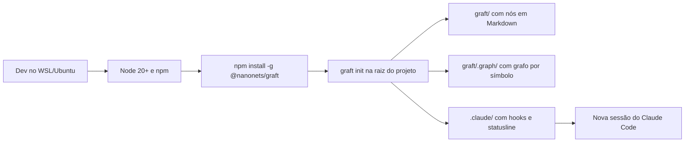
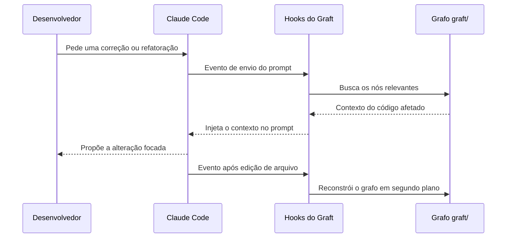
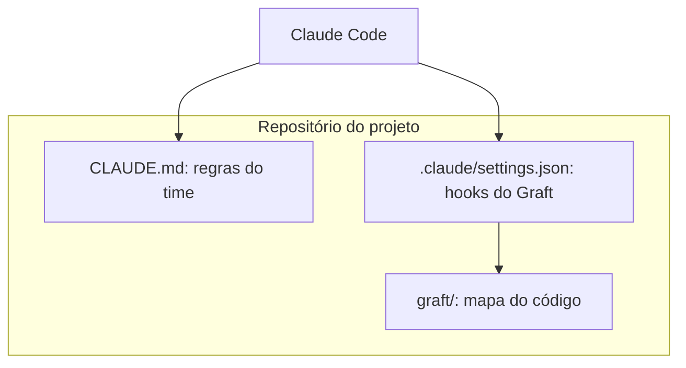

# Graft + Claude Code no WSL/Ubuntu: guia de configuração para o time

Este pacote configura o **Graft** em um projeto que usa **Claude Code**, dentro de **WSL/Ubuntu**. Foi escrito para times com desenvolvedores juniores: poucos comandos, passos claros e um único fluxo recomendado.

---

## Sumário

1. [O que é o Graft](#1-o-que-é-o-graft)
2. [Vantagens para o Claude Code](#2-vantagens-para-o-claude-code)
3. [Conteúdo do pacote](#3-conteúdo-do-pacote)
4. [Pré-requisitos](#4-pré-requisitos)
5. [Instalação automatizada](#5-instalação-automatizada-recomendada)
6. [Instalação manual](#6-instalação-manual)
7. [Como funciona (diagramas)](#7-como-funciona-diagramas)
8. [CLAUDE.md do projeto](#8-claudemd-do-projeto)
9. [Uso no dia a dia](#9-uso-no-dia-a-dia)
10. [O que versionar no Git](#10-o-que-versionar-no-git)
11. [Solução de problemas](#11-solução-de-problemas)
12. [Referências oficiais](#12-referências-oficiais)

---

## 1. O que é o Graft

Graft é um CLI open source (licença MIT, publicado no npm como `@nanonets/graft`) que gera um **mapa do repositório** para agentes de código. Ele produz dois artefatos:

| Artefato                    | Local           | Função                                                                                  |
| --------------------------- | --------------- | --------------------------------------------------------------------------------------- |
| Grafo de código por símbolo | `graft/.graph/` | Funções, classes e chamadas, extraídas de forma determinística com tree-sitter, sem LLM |
| Nós de contexto em Markdown | `graft/`        | Páginas ligadas entre si que descrevem subsistemas e conceitos em linguagem simples     |

O `graft init` também integra o Graft ao Claude Code: instala uma *statusline* e *hooks* em `.claude/` e, a partir da sessão seguinte, injeta os nós relevantes em cada prompt e reconstrói o grafo em segundo plano.

## 2. Vantagens para o Claude Code

| Vantagem                           | Justificativa                                                                                                                                                                                       |
| ---------------------------------- | --------------------------------------------------------------------------------------------------------------------------------------------------------------------------------------------------- |
| Menos exploração às cegas          | O agente começa orientado pelo mapa, em vez de varrer arquivos com `grep` a cada tarefa                                                                                                             |
| Menor custo e tempo                | O projeto reporta cerca de 46% menos chamadas de ferramenta, 42% menos tokens de entrada não cacheados e até 60% menos tempo em seus benchmarks (medições do próprio projeto; valide no seu código) |
| Adoção simples                     | Dois comandos (`npm install -g @nanonets/graft` e `graft init`); não exige banco de dados nem servidor para operar                                                                                  |
| Execução local                     | A camada estrutural roda localmente; não há envio do código a serviço de índice                                                                                                                     |
| Seguro para configuração existente | `graft init` é idempotente e faz *merge* em `.claude/settings.json`, sem sobrescrever o que já existe                                                                                               |
| Pré-visualização                   | `graft init --dry-run` lista os arquivos que seriam alterados antes de qualquer escrita                                                                                                             |
| Boa curva para juniores            | O time continua usando o Claude Code normalmente; o Graft age por trás via hooks                                                                                                                    |

## 3. Conteúdo do pacote

```text
graft-starter/
├── README.md             Este guia
├── setup-graft.sh        Instalação automatizada (WSL/Ubuntu)
├── CLAUDE.md.exemplo     Modelo de instruções do time para o Claude Code
└── CHECKLISTS.md         Checklists de setup, uso diário, PR e problemas
```

## 4. Pré-requisitos

- WSL com Ubuntu (22.04 ou superior).
- Node.js 20 ou superior (`node -v`) e npm (`npm -v`).
- Git instalado e projeto clonado **dentro do sistema de arquivos Linux** (por exemplo `~/projetos/minha-api`), e não em `/mnt/c/...`, que é bem mais lento.
- Claude Code instalado e funcionando no WSL.

## 5. Instalação automatizada (recomendada)

1. Copie esta pasta para o repositório, por exemplo em `tools/graft-starter/`.

2. Na raiz do projeto, simule primeiro (nada é alterado):
   
   ```bash
   bash tools/graft-starter/setup-graft.sh --dry-run
   ```

3. Execute de verdade:
   
   ```bash
   bash tools/graft-starter/setup-graft.sh
   ```

4. Abra uma **nova sessão** do Claude Code na raiz do projeto.

O script verifica Node 20+, npm e Git; instala o Graft se necessário; roda `graft init` apenas para o Claude Code; e confere o resultado. Use `bash tools/graft-starter/setup-graft.sh --help` para ver as opções.

## 6. Instalação manual

```bash
# 1. Instalar o CLI
npm install -g @nanonets/graft

# 2. Na raiz do projeto: pré-visualizar as alterações
cd ~/projetos/minha-api
graft init --agents claude --no-global --dry-run

# 3. Aplicar
graft init --agents claude --no-global

# 4. Conferir
ls graft/
ls .claude/
```

Alternativa sem instalação global: `npx @nanonets/graft init`.

> Se alguma opção não for reconhecida na sua versão, rode `graft init --help` e ajuste. O comando `graft init` sem opções também funciona e pergunta quais agentes integrar.

## 7. Como funciona (diagramas)

### 7.1 Instalação



### 7.2 Uso em uma tarefa



### 7.3 Papel de cada arquivo



## 8. CLAUDE.md do projeto

O Claude Code lê o **`CLAUDE.md`** (na raiz ou em `.claude/CLAUDE.md`) no início de cada sessão. Ele guarda as regras e convenções do time. O `AGENTS.md` é o equivalente usado por outros agentes e não é o arquivo nativo do Claude Code.

- O Graft **não** escreve no seu `CLAUDE.md`; ele usa hooks, a configuração em `.claude/settings.json` e uma skill própria. Por isso o `CLAUDE.md` continua sob controle do time.
- Use `CLAUDE.md.exemplo` como ponto de partida: copie para `CLAUDE.md` (ou rode `/init` no Claude Code para gerar um inicial e depois mescle).
- Lembre que o `CLAUDE.md` é contexto, não configuração obrigatória. Para impedir ações de forma garantida, use hooks.

## 9. Uso no dia a dia

Comandos principais (veja `graft --help` para a lista completa da sua versão):

| Comando                   | Quando usar                                                      |
| ------------------------- | ---------------------------------------------------------------- |
| `graft map`               | Entender a arquitetura geral                                     |
| `graft ask "pergunta"`    | Descobrir onde algo está e como funciona                         |
| `graft callers <símbolo>` | Ver o impacto antes de mudar uma função                          |
| `graft build`             | Regenerar o grafo local (por exemplo, após clonar o repositório) |

Veja `CHECKLISTS.md` para os passos antes de começar uma tarefa e antes de abrir um PR.

## 10. O que versionar no Git

As fontes divergem sobre quanto do `graft/` vai para o Git. Adote esta regra simples e confirme olhando o `git status` após o `graft init`:

- **Versione**: a configuração em `.claude/` criada pelo Graft e o `CLAUDE.md`.
- **Decisão do time**: as páginas Markdown em `graft/` (úteis para revisão em PR, mas geram diffs).
- **Não versione**: `graft/.graph/` e caches regeneráveis; cada pessoa pode rodar `graft build`.

Registre a decisão do time no `CLAUDE.md` para que todos sigam a mesma regra.

## 11. Solução de problemas

| Sintoma                        | Causa provável                     | Ação                                                          |
| ------------------------------ | ---------------------------------- | ------------------------------------------------------------- |
| `bad interpreter: /bin/bash^M` | Fim de linha CRLF vindo do Windows | `sed -i 's/\r$//' tools/graft-starter/setup-graft.sh`         |
| `EACCES` no `npm install -g`   | Prefixo global do npm exige root   | Use `nvm`, ou `npx @nanonets/graft init`                      |
| `graft: command not found`     | PATH do npm global não carregado   | Abra novo terminal ou ajuste o PATH                           |
| Node abaixo de 20              | Versão antiga no Ubuntu            | Instale Node 20+ com `nvm install 20`                         |
| Claude Code não usa o Graft    | Sessão aberta antes do `init`      | Feche e abra nova sessão na raiz do projeto                   |
| Lentidão                       | Repositório em `/mnt/c`            | Clone dentro de `~/` no WSL                                   |
| Reverter                       | Mudanças de configuração indevidas | Desfazer com Git as mudanças em `.claude/` e remover `graft/` |

Para desfazer, reverta com Git as mudanças em `.claude/` e remova a pasta `graft/`.

## 12. Referências oficiais

- Repositório oficial: https://github.com/NanoNets/Graft
- Produto (Trail): https://trailhq.com/graft
- Claude Code, memória e `CLAUDE.md`: https://code.claude.com/docs/en/memory
